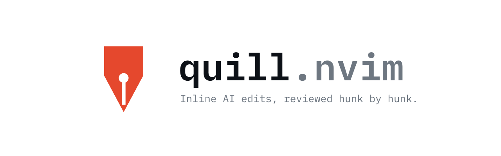
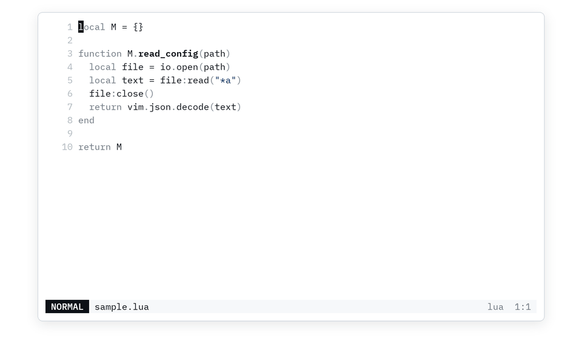
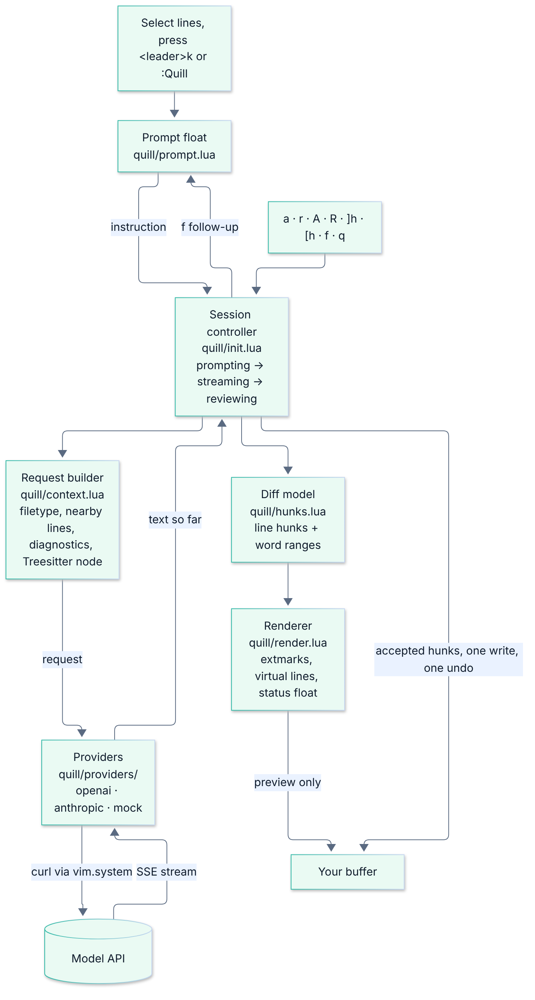

<p align="center">
  <picture>
    <source media="(prefers-color-scheme: dark)" srcset="assets/banner-dark.png">
    
  </picture>
</p>

Select code, describe the change, and review the rewrite hunk by hunk before it touches
your buffer.

<picture>
  <source media="(prefers-color-scheme: dark)" srcset="assets/demo-dark.gif">
  
</picture>

## Features

- **Preview before anything changes.** The rewrite streams in as an overlay on your code.
  The buffer text stays the same until you finish reviewing.
- **Hunk-by-hunk review.** Accept or reject each change on its own, or all of them at once.
- **One undo step.** Everything you accepted lands as a single change, so one `u` restores
  the original.
- **Follow-ups.** Press `f` to refine the current proposal ("also add types") without
  starting over.
- **Use the subscription you already pay for.** Run edits through your ChatGPT plan (Codex
  CLI), Claude plan (Claude Code), or GitHub Copilot, with no API key.
- **Or any API.** OpenAI, Anthropic, and any OpenAI-compatible server such as Ollama,
  LM Studio, vLLM, or OpenRouter.
- **Context-aware prompts.** Each request includes the filetype, surrounding lines, the
  enclosing Treesitter node, and diagnostics in the selection.
- **Fits your colorscheme.** Highlights are derived from your theme and update when it
  changes.

## Requirements

- Neovim 0.10 or newer
- `curl` for the API and Copilot providers, or the `codex` / `claude` CLI for those providers

## Install

With [lazy.nvim](https://github.com/folke/lazy.nvim):

```lua
{ "juswag/quill.nvim", opts = {} }
```

With another plugin manager, call `require("quill").setup({})` yourself. Setup creates the
`<leader>k` visual-mode mapping.

## How to use

1. Select lines in visual mode and press `<leader>k` (or run `:'<,'>Quill`).
2. Type what you want changed, for example `add error handling`, and press `<CR>`.
3. Watch the proposal stream in. Removed lines are tinted red, added lines appear in green,
   and the changed words are highlighted.
4. Review each hunk with the keys below. When none are left, the accepted ones are applied.

| Key | Action |
| --- | --- |
| `a` / `r` | Accept or reject the current hunk |
| `A` / `R` | Accept or reject all remaining hunks |
| `]h` / `[h` | Jump to the next or previous hunk |
| `f` | Refine the proposal with a follow-up |
| `q` / `<Esc>` | Cancel and clear the preview |

`:'<,'>Quill make this async` skips the prompt. `:QuillCancel` ends a session from anywhere
in the buffer. Rejecting everything leaves the file untouched.

## Choose a provider

quill uses OpenAI by default and reads the key from `OPENAI_API_KEY`. Set `provider` to
switch.

### With a subscription (no API key)

| Provider | Uses | One-time setup |
| --- | --- | --- |
| `codex` | ChatGPT plan via the [Codex CLI](https://github.com/openai/codex) | `npm i -g @openai/codex && codex login` |
| `claude_code` | Claude Pro/Max via [Claude Code](https://docs.claude.com/en/docs/claude-code) | `npm i -g @anthropic-ai/claude-code`, then `claude` and `/login` |
| `copilot` | GitHub Copilot | Sign in with [copilot.vim](https://github.com/github/copilot.vim) (`:Copilot setup`) or [copilot.lua](https://github.com/zbirenbaum/copilot.lua) (`:Copilot auth`) |

```lua
opts = { provider = "claude_code" }
```

The CLIs run read-only (Codex with `--sandbox read-only`, Claude Code with no tools). Codex
returns its answer in one piece, so its preview fills in all at once. The `copilot`
provider uses GitHub's undocumented token endpoint, which can change without notice.

### With an API key

```lua
-- Anthropic, key from ANTHROPIC_API_KEY
opts = { provider = "anthropic" }

-- Ollama, or any OpenAI-compatible server
opts = {
  provider = "ollama",
  providers = {
    ollama = { format = "openai", base_url = "http://localhost:11434/v1", model = "qwen2.5-coder", api_key = "ollama" },
  },
}
```

## Configuration

<details>
<summary>Defaults</summary>

```lua
require("quill").setup({
  provider = "openai",        -- a key of `providers`
  providers = {
    openai = { base_url = "https://api.openai.com/v1", model = "gpt-4o-mini", api_key_env = "OPENAI_API_KEY" },
    anthropic = { base_url = "https://api.anthropic.com/v1", model = "claude-sonnet-4-5", api_key_env = "ANTHROPIC_API_KEY" },
    codex = {},               -- ChatGPT plan through the Codex CLI
    claude_code = {},         -- Claude plan through Claude Code
    copilot = { model = "gpt-5-mini" }, -- GitHub Copilot sign-in
    mock = {},                -- offline provider used by the tests and the demo
  },
  context_lines = 20,         -- lines above and below the selection sent as context
  mapping = "<leader>k",      -- visual-mode mapping, false to disable
  keys = {
    accept = "a", reject = "r", accept_all = "A", reject_all = "R",
    next = "]h", prev = "[h", followup = "f", cancel = { "q", "<Esc>" },
  },
})
```

</details>

`codex` and `claude_code` also accept `cmd`, `args`, `model`, and `timeout_ms` (default
120000). Every highlight group is named `Quill*` and can be overridden. Full reference:
`:help quill.txt`.

## How it works



A small state machine (prompting, streaming, reviewing) drives each session. Providers
stream text through curl or a CLI, `vim.diff` splits the result into hunks, and the preview
is drawn with extmarks only, so the buffer is written once at the end.

## Limitations

- Hunks are whole-line diffs, and selections are widened to whole lines.
- A follow-up resets your hunk decisions.
- Editing inside the range during a session is not supported.

## Development

```sh
./test.sh                     # headless test suites
NVIM=/path/to/nvim ./test.sh  # against a specific Neovim
```

Tests need `nvim`, `curl`, and `python3`. `demo/record.sh` re-records the demo.

## License

[MIT](LICENSE)
